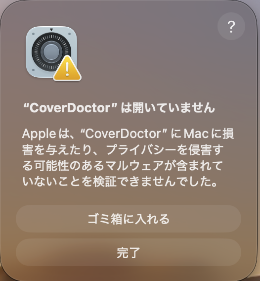
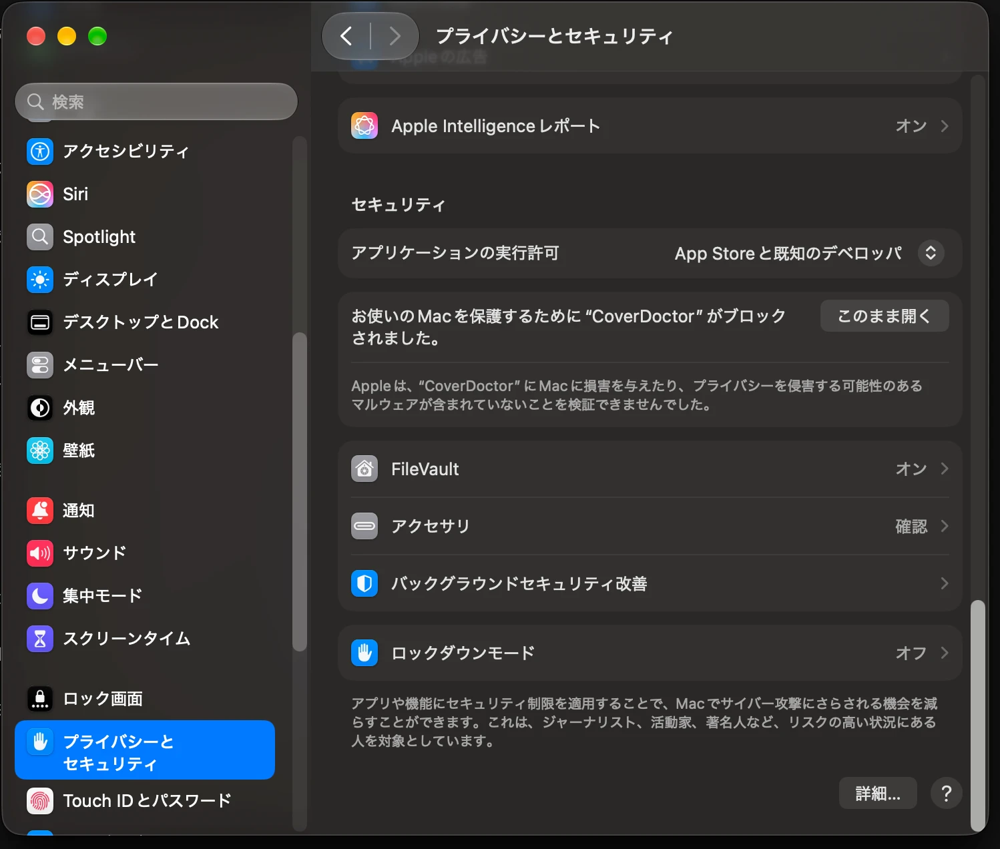
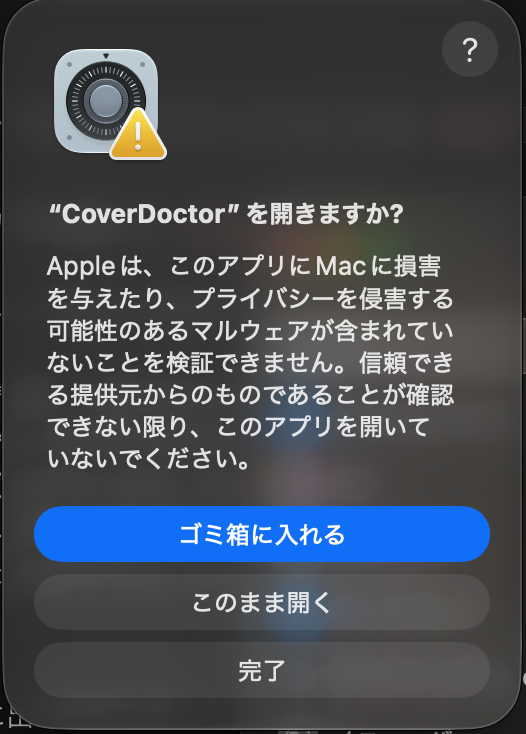
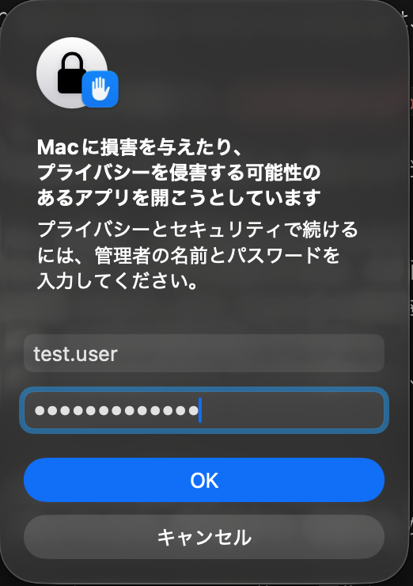
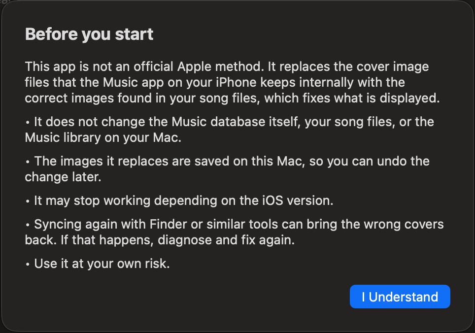
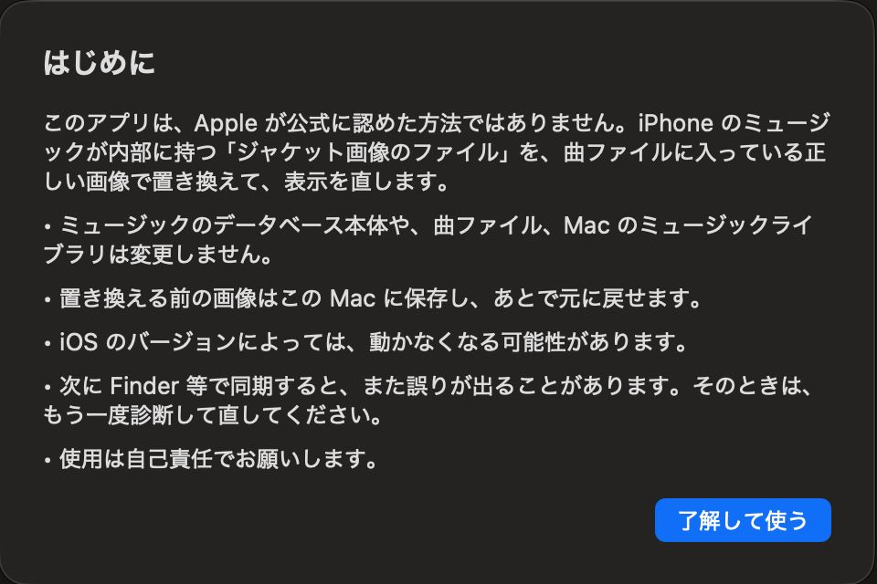

# Cover Doctor


**English** | [日本語](#日本語)

Fixes the problem where the Music app on your iPhone shows **another album's cover** after you sync music from a Mac or PC.

> Status: early version (0.1). Unofficial. Verified only on one iPhone (iOS 27.0) with a Mac running macOS 27.0.1 (see *What has been tested*). Use at your own risk.

## Download

Both versions share the same version number and are on the same [Releases page](https://github.com/toorumaeda/cover-doctor/releases). Pick the file for your computer; the OS is in the file name.

### Mac

- File: `CoverDoctor-<version>-macOS-arm64.zip` (Apple Silicon Macs, macOS 14 or later).
- Unzip it and follow *Opening the app for the first time* below (macOS blocks the first launch).
- Check the download with the `.sha256` file next to it: `shasum -a 256 CoverDoctor-<version>-macOS-arm64.zip`.

### Windows

- File: `CoverDoctor-<version>-Windows-x64.zip` (Windows 10/11, 64-bit). iTunes or the Apple Devices app must be installed.
- Unzip the whole folder and run `CoverDoctor.exe`. Windows SmartScreen warns on first launch (More info → Run anyway).
- Check the download with the `.sha256` file next to it: `Get-FileHash CoverDoctor-<version>-Windows-x64.zip` in PowerShell.
- Verified on Windows 11 only. See [windows/README.md](windows/README.md) (Japanese) and the `README.txt` inside the zip.

Questions and reports (what worked and what did not, with your macOS and iOS versions): [Issues](https://github.com/toorumaeda/cover-doctor/issues).

## What it does

After a Finder / Apple Music sync, the cover image file that the iPhone stores for an album can end up containing **another album's picture**, even though the song files themselves carry the correct embedded artwork. Cover Doctor:

1. **Diagnoses** (read only): reads the iPhone's library information, extracts the embedded cover from one song per album, and compares it with the image the iPhone currently uses.
2. **Fixes**: overwrites only the wrong cover *image files* inside the iPhone's artwork store with the correct images. It never writes to the database, your songs, or your Mac's library.
3. **Undoes**: the images it replaces are saved on your Mac first, so the change can be reverted.

**Playlist covers** are handled too. A playlist has no cover inside any song file, so Cover Doctor builds one from the playlist's own albums: a 2×2 collage of the first four albums, or the first album's cover if there are fewer than four. It only replaces a playlist cover that matches *another* album in your library and none of the playlist's own albums. A cover that matches no album at all may be one you set yourself, so it is left alone and reported.

## How it works

The Music app on the iPhone reaches a cover like this:

```
album  →  artwork token  →  image file path  →  image file (Artwork/Originals)
```

After a sync, the image file at the end of this chain can contain **another album's** picture, while the song files still carry the correct embedded cover. In the author's case every album still had its own token and its own file; many of those files held identical copies of the same unrelated cover (167 albums showed only 37 different pictures). Whether the wrong picture is created by the Mac-side sync or by the iPhone is **not known**.

**Diagnose (read only)**
1. Copy and read the iPhone's library database (`MediaLibrary.sqlitedb`).
2. For each album in the library, find which image file it currently uses.
3. Pull one song of that album from the iPhone and read the cover embedded in it. If a song has none, try another (up to 8; the song the database names as the source of the album art is tried first).
4. Compare the embedded cover with the image the iPhone uses, by appearance: both are shrunk to a small grayscale pattern (a 256-bit "dHash") and compared, so the same picture at a different size or compression counts as the same.
5. Result per album: **correct**, **fixable** (wrong image), or **not fixable** (no cover inside the songs).

**Fix**
1. Save the current image files on your Mac (first time only; never overwritten).
2. Overwrite only the wrong albums' image files with the correct images.
3. Read each file back and check it by appearance.
4. Record what was replaced, which is what **Undo** uses.

**Undo** writes the saved images back to the same places.

**Safety limits.** It never writes to the database, your song files, or your Mac's library. The only thing it can write is an *existing* file in the iPhone's cover image store; creating files, deleting files, and `../` path tricks are refused by the helper tool (covered by `Tests/run_e2e.sh`).

## What has been tested

Cover Doctor has been tested **only on the author's own setup**:

| | Verified |
|---|---|
| Mac | Apple Silicon (arm64), **macOS 27.0.1 (build 26A434)**, Xcode 27.0 (27A266a) used to build |
| iPhone | One iPhone (model ID iPhone19,2, "iPhone 18 Pro"), **iOS 27.0 (build 24A437)** |
| Library on that iPhone | 8,515 songs, 701 albums (500 of them with a cover record that Cover Doctor can check), 13 playlists |
| Date | 2026-10-18 |
| What worked | From the app window on the real iPhone: diagnose, fix (albums and playlist covers), re-diagnose, and undo followed by diagnose and fix again (the author did this on 2026-10-18). Automated tests (including undo) run against a *fake iPhone* |

**Not verified:** macOS 14, 15 and 26 (the app is built to run on macOS 14 or later, but the author has no older Mac to try it on), other iOS versions, Intel Macs, and library sizes very different from the above. The versions in the table are exactly what was used; "it works on the newest macOS/iOS" should not be read as "it works on every version". It may not work, or may behave differently, in those cases.

If you try it on another setup, please report what happened (what worked and what did not), including your macOS and iOS versions. That is very helpful.

## Limits (please read)

- **Undo restores only the image files that this app saved.** It does not restore the Music database or iPhone caches, and an iPhone backup is not a substitute for it (whether a backup restores these internal files is unverified).
- Matching is done by appearance (see *How it works*). Two almost identical covers may be judged the same, and the thresholds were measured on one library only.
- **Not verified:** iCloud Music Library turned **on**, and Apple Music subscription songs. The author's tests used local files with iCloud Music Library off.
- Albums whose song files have **no embedded cover image** cannot be fixed.
- A later sync can bring the wrong covers back. Run the diagnosis again and fix again.
- It relies on how iOS stores artwork internally. A future iOS update may break it.
- Built for **macOS 14 or later on Apple Silicon**, but only tested on macOS 27 (see *What has been tested*). Intel Macs are not supported yet. For Windows, see *Download* above.
- Not affiliated with Apple. "iPhone" and "Music" are trademarks of Apple Inc.

## How to use

1. Connect your iPhone with a USB cable, unlock it, and choose **Trust This Computer**.
2. Open Cover Doctor and press **Diagnose**. The first run extracts artwork from your songs and can take a few minutes.
3. Review the list (left: current cover, right: the image after the fix) and press **Fix**.
4. Fully quit the Music app on the iPhone and open it again.

## Opening the app for the first time (macOS warning)

Cover Doctor is not signed with an Apple Developer ID and is not notarized, so macOS blocks it the first time you open it. This is expected. You only need to allow it once.

1. Move `CoverDoctor.app` to your **Applications** folder (or anywhere you like), then double-click it. macOS says it cannot verify the app. Press **Done** (do *not* press "Move to Trash").

   

2. Open **System Settings → Privacy & Security** and scroll to the bottom. Next to “CoverDoctor was blocked…”, press **Open Anyway**.

   

3. A confirmation appears. Press **Open Anyway** again.

   

4. macOS asks for your administrator name and password. Enter them, and the app opens. From now on it opens normally.

   

5. The first time, Cover Doctor shows a short notice (it is unofficial; what it does and does not change). Read it and press **I Understand**.

   

*The screenshots are from Japanese macOS 27.0.1; on an English system the button names are the English ones used above and may differ slightly between macOS versions.*

If you are comfortable with the Terminal, you can instead remove the download mark once: `xattr -dr com.apple.quarantine /Applications/CoverDoctor.app`.

Only download Cover Doctor from this project's own release page, and never open an app that you do not trust just because it shows this warning.

## Build and test

```bash
bash Tools/build_libs.sh <folder with the source tarballs>   # once: builds the libraries into Dependencies/prefix (see the script header)
./build-app.sh            # builds build/CoverDoctor.app (ad-hoc signed)
bash Tests/run_e2e.sh     # end-to-end tests against a fake iPhone (needs ffmpeg); never touches a real device
SCALE=150 bash Tests/run_e2e.sh   # same, with 150 extra albums
bash Tests/run_gui_selftest.sh    # runs the app's own model (the code behind the buttons) against the fake iPhone
bash Tests/run_gui_fake.sh en   # opens the app connected to the fake iPhone
```

The fake iPhone is a folder with the same layout as the iPhone's media area. It is enabled only by the `COVERDOCTOR_FAKE_ROOT` environment variable.

## License

MIT License, Copyright (c) 2026 Toru Maeda. See `LICENSE`.

## Third-party software

See `THIRD_PARTY_NOTICES.md` (libimobiledevice and related libraries, LGPL-2.1, shipped as replaceable `.dylib` files inside the app; OpenSSL, Apache-2.0). License texts are in `Licenses/`.

---

## 日本語

Mac や PC から iPhone に音楽を同期したあと、iPhone のミュージックで**別のアルバムのジャケットが表示される**問題を直すアプリです。

> 状態: 初期版（0.1）。非公式です。macOS 27.0.1 の Mac と、iPhone 1台（iOS 27.0）でのみ動作を確認しています（「動作確認の範囲」を参照）。自己責任でお使いください。

### ダウンロード

Mac 版と Windows 版は、同じ版番号で、同じ [Releases ページ](https://github.com/toorumaeda/cover-doctor/releases)に並んでいます。お使いのパソコンに合うファイルを選んでください。ファイル名に OS が入っています。

#### Mac をお使いの方

- ファイル: `CoverDoctor-<バージョン>-macOS-arm64.zip`（Apple Silicon の Mac、macOS 14 以上）
- 解凍して、下の「初めて開くとき」の手順に従ってください（初回は macOS に止められます）。
- 横の `.sha256` のファイルで、ダウンロードを確認できます: `shasum -a 256 CoverDoctor-<バージョン>-macOS-arm64.zip`

#### Windows をお使いの方

- ファイル: `CoverDoctor-<バージョン>-Windows-x64.zip`（Windows 10/11 の 64 ビット）。iTunes か「Apple デバイス」アプリが必要です。
- フォルダごと解凍して、`CoverDoctor.exe` を開きます。初回は Windows SmartScreen の警告が出るので、「詳細情報」→「実行」を選んでください。
- 横の `.sha256` のファイルで、ダウンロードを確認できます: PowerShell で `Get-FileHash CoverDoctor-<バージョン>-Windows-x64.zip`
- 動作確認は Windows 11 のみです。詳しくは [windows/README.md](windows/README.md) と、zip の中の `README.txt` を見てください。

質問や報告（動いたこと、動かなかったこと。macOS と iOS のバージョンも）は、[Issues](https://github.com/toorumaeda/cover-doctor/issues) へお願いします。

### できること

Finder や Apple Music での同期のあと、iPhone がアルバムごとに保存しているジャケット画像ファイルの**中身が、別のアルバムの絵になってしまう**ことがあります。曲ファイルには、正しい画像が埋め込まれているのにです。Cover Doctor は次のことをします。

1. **診断**（読み取りのみ）: iPhone のライブラリ情報を読み、アルバムごとに1曲から埋め込みジャケットを取り出し、iPhone が今使っている画像と比べます。
2. **修復**: iPhone 内のジャケット画像の保管場所にある、誤った画像**ファイルだけ**を、正しい画像で上書きします。データベース、曲ファイル、Mac のライブラリには書き込みません。
3. **元に戻す**: 置き換える前の画像は先に Mac に保存するので、あとで元に戻せます。

### 仕組み

iPhone のミュージックは、ジャケットを次の順にたどって表示します。

```
アルバム  →  画像の番号（トークン）  →  画像ファイルの場所  →  画像ファイル（Artwork/Originals）
```

同期のあと、この連なりの最後にある画像ファイルの**中身が、別のアルバムの絵**になってしまうことがあります。作者の場合、どのアルバムも、自分のトークンと自分のファイルを持っていて、そのファイルの多くが、同じ誤った絵の複製でした（167アルバムが、37種類の絵しか持っていませんでした）。誤った絵を作っているのが、Mac 側の同期なのか、iPhone なのかは、**分かっていません**。一方で、曲ファイルの中には、正しいジャケットが埋め込まれたままです。

**診断（読み取りのみ）**
1. iPhone のライブラリ情報（`MediaLibrary.sqlitedb`）をコピーして読みます。
2. ライブラリにある各アルバムについて、今どの画像ファイルを使っているかを調べます。
3. そのアルバムの曲を1曲 iPhone から取り出し、中に埋め込まれたジャケットを読みます。曲に画像が無ければ、次の曲を試します（最大8曲。DB が「アルバム画像の出どころ」と示す曲を、先に試します）。
4. 埋め込みのジャケットと、iPhone が使っている画像を、見た目で比べます。どちらも小さな白黒の模様（256ビットの dHash）に縮めて比べるので、解像度や圧縮が違うだけの同じ絵は、「同じ」と判定されます。
5. アルバムごとの結果は、**正しい**、**直せる**（誤った画像）、**直せない**（曲にジャケットが入っていない）のいずれかです。

**修復**
1. 今の画像ファイルを、Mac に保存します（最初の1回だけ。上書きしません）。
2. 誤っているアルバムの画像ファイルだけを、正しい画像で上書きします。
3. 1枚ずつ読み戻して、見た目で確認します。
4. 置き換えた内容を記録します。これが「元に戻す」の材料です。

**元に戻す**は、保存した画像を、同じ場所に書き戻します。

**安全のための制限。** データベース、曲ファイル、Mac のライブラリには、書き込みません。書き込めるのは、iPhone のジャケット画像の保管場所にある**既存のファイル**だけです。ファイルの新規作成、削除、`../` を使った抜け道は、補助ツールが拒否します（`Tests/run_e2e.sh` で確認しています）。

### 動作確認の範囲

Cover Doctor は、**作者自身の環境でしか、動作を確認していません**。

| | 確認できたもの |
|---|---|
| Mac | Apple Silicon（arm64）、**macOS 27.0.1（ビルド 26A434）**。ビルドには Xcode 27.0（27A266a）を使用 |
| iPhone | iPhone 1台（機種ID iPhone19,2、「iPhone 18 Pro」）、**iOS 27.0（ビルド 24A437）** |
| その iPhone のライブラリ | 8,515曲、701アルバム（うち、画像の記録があって Cover Doctor が診断できるのが500）、プレイリスト13件 |
| 確認日 | 2026年10月18日 |
| 動いたこと | 実機の iPhone で、アプリの画面から、診断、修復（アルバムとプレイリストのカバー）、再診断、そして「元に戻す」→ 診断 → 修復のやり直し（作者が2026年10月18日に実施）。自動テスト（「元に戻す」を含む）は、*偽の iPhone*で行っています |

**確認できていないもの:** macOS 14、15、26（macOS 14 以上で動くように作っていますが、作者は古い Mac を持っておらず、試せていません）、ほかの iOS のバージョン（表のバージョンが、実際に使ったものです。「最新で動いた」ことは、ほかのバージョンでも動くことを意味しません）、Intel Mac、上記と大きく違う規模のライブラリ。これらの環境では、動かない、または、違う動きをするかもしれません。

別の環境で試された場合は、動いたこと、動かなかったことを、macOS と iOS のバージョンとあわせて、教えてください。とても助かります。

### 制限（必ずお読みください）

- **「元に戻す」が戻すのは、このアプリが保存した画像ファイルだけです。** ミュージックのデータベースや iPhone のキャッシュは戻しません。iPhone のバックアップは、代わりになりません（バックアップから、これらの内部ファイルが戻るかは、未確認です）。
- 見た目で判定しています（「仕組み」を参照）。ほとんど同じ2枚のジャケットは、同じと判定されることがあり、しきい値は、1つのライブラリだけで測っています。
- **未確認:** iCloud ミュージックライブラリを**オン**にした場合と、Apple Music の契約曲。作者の確認は、iCloud ミュージックライブラリをオフにした、ローカルのファイルだけです。
- 曲に**ジャケット画像が埋め込まれていない**アルバムは、直せません。
- あとで同期すると、また誤りが出ることがあります。その場合は、もう一度診断して直してください。
- iOS の内部の保存方法に依存しています。将来の iOS の更新で、動かなくなる可能性があります。
- **Apple Silicon の macOS 14 以上**向けに作っていますが、動作確認は macOS 27 でしかしていません（「動作確認の範囲」を参照）。Intel Mac には、まだ対応していません。Windows 版は、上の「ダウンロード」を見てください。
- Apple とは関係ありません。「iPhone」「ミュージック（Music）」は Apple Inc. の商標です。

### 使い方

1. iPhone を USB でつなぎ、ロックを解除して、「このコンピュータを信頼」を選びます。
2. Cover Doctor を開いて、「診断する」を押します。初回は曲から画像を取り出すので、数分かかることがあります。
3. 一覧（左: 今のジャケット、右: 直したあとの画像）を確認して、「直す」を押します。
4. iPhone のミュージックアプリを完全に終了して、開き直します。

### 初めて開くとき（macOS の警告）

Cover Doctor は、Apple の開発元 ID（Developer ID）で署名されておらず、公証（notarization）も受けていません。そのため、最初に開くときに、macOS が止めます。これは想定された動きで、許可は1回だけで済みます。

1. `CoverDoctor.app` を、**アプリケーション**フォルダ（どこでも構いません）に移して、ダブルクリックします。「開いていません」と出ます。**「完了」**を押します（「ゴミ箱に入れる」は、押さないでください）。

   

2. **システム設定 → プライバシーとセキュリティ**を開いて、一番下までスクロールします。「…“CoverDoctor”がブロックされました」の横の、**「このまま開く」**を押します。

   

3. 確認の画面が出ます。もう一度、**「このまま開く」**を押します。

   

4. 管理者の名前とパスワードを、聞かれます。入力すると、アプリが開きます。次回からは、普通に開きます。

   

5. 初回だけ、「はじめに」の画面が出ます（非公式であること、何を変更して、何を変更しないか）。読んで、**「了解して使う」**を押します。

   

*画像は、日本語の macOS 27.0.1 のものです。ボタンの名前は、macOS のバージョンで、少し違うことがあります。*

ターミナルに慣れている方は、代わりに、ダウンロードの印を、1回だけ外す方法もあります: `xattr -dr com.apple.quarantine /Applications/CoverDoctor.app`

Cover Doctor は、このプロジェクトの公式のリリースページからだけ、ダウンロードしてください。信頼できないアプリを、この警告が出るというだけの理由で、開かないでください。

### ライセンス

MIT ライセンス、Copyright (c) 2026 Toru Maeda（`LICENSE`）。同梱ライブラリのライセンスは、`THIRD_PARTY_NOTICES.md` と `Licenses/` を参照してください。
